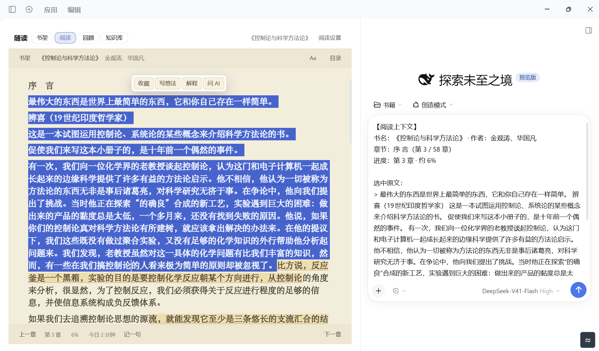

# 随读 · 读书搭档（dsh-readmate）

左边阅读书目，可以划线收藏记录想法，右边和 AI 对话分析提问。想法笔记自动分类存入本地知识库。支持 EPUB、PDF、AZW3、TXT 等文件。

一个安静的 AI 阅读工作台：把书放进一个文件夹，书架自己就长出来了；读到心里一动的地方，AI 顺手把想法收进你自己的知识库。

> DSH Desktop 工作台插件，工作台内部 = 阅读器（左，约 60%）+ 宿主原生对话（右）。




## 示例：两本书，两种读法

把书放进你的书籍文件夹（例如 Calibre 库的导出目录）即可，例如：

- **《献给阿尔吉侬的花束》.epub** — EPUB 直接打开，左侧阅读器分章显示，划词即可提问。
- **《深度学习入门：基于Python的理论与实现》.pdf** — PDF 第一次打开时会用本机 Calibre 自动转成可读版本（稍等片刻，之后走缓存），随后和 EPUB 一样分章阅读、划词提问；原 PDF 不会被修改。

两本书都在同一个书架里，进度、笔记和知识库不分格式。

## 它能做什么

- **自动书架**：扫描你指定的书籍文件夹（支持 Calibre 那种「作者/书名/书籍文件」的层级），显示封面与书名，随时继续上次读到的地方。
- **常用电子书格式**：EPUB、TXT 直接阅读；PDF、AZW3、MOBI、AZW、FB2 使用本机 Calibre 转换后阅读。书架固定封面网格，支持选择、拖入及粘贴导入；导入结果以临时浮层显示。
- **章节名自动整理**：PDF、AZW3 这类转出来的书原本没有目录，插件会按正文里的首个标题给每一章命名，而不是让你面对一串「第 1 节、第 2 节」。
- **封面自动兜底**：优先用书旁/书里的封面图；没有封面时，用正文第一页的文字做成安静的纸页封面。
- **安静阅读**：目录、正文、字号/行距/字体/阅读主题，进度自动保存，重开应用接着读。
- **选中即问**：选中正文里的句子，可以「收藏」「写想法」「解释」「问 AI」；提问时书名、作者、章节和原文会自动带上，不用复制粘贴。
- **自动知识库**：你说出的观点、联想、疑问会被整理成 Markdown 知识卡片（原始表达 + 核心观点 + 出处 + 关联），并自动双向链接；也能一键收藏原文。
- **跨书检索**：按书、按主题、按自然语言查找以前的想法；卡片之间能互相跳转。
- **读完成文**：读完一本书时，AI 会把你这次的思考和对话整理成一篇读后文章存进知识库。

## 安装

### 从工作台市场安装

在 DSH Desktop 的「工作台市场」里找到「随读 · 读书搭档」并安装，重启桌面应用即可在左侧工作台切换入口看到它。

### 手动安装（开发者）

```bash
# 在 DSH Desktop 的 profile 目录，或使用插件管理器
pnpm add <本仓库路径或 tgz>
```

本包同时包含 Host 半边（`index.js` / `core.js`：EPUB 解析、多格式读取、知识库读写、Agent 工具、`/reading` RPC 路由）与 Client 半边（`client.js`：工作台界面），
通过 `cordis.patch.yml` 注册插件层与「随读」Agent 预设。

## 首次使用

1. 打开工作台，选择你的书籍文件夹（例如 Calibre 导出目录）。
2. 选择知识库目录（默认 `~/Reading-KB`），之后不用再设置。
3. 点右侧「开始对话」（或在选中原文时点「问 AI」）和 AI 边读边聊。

知识库结构：

```
Reading-KB/
  index.md      全局知识索引（可重建）
  books/        每本书的基本信息与阅读记录
  notes/        独立知识卡片（Markdown）
  reports/      读后文章
```

原始书籍文件只读：插件不会修改、移动或覆盖你的书籍文件；需要格式转换时只是另存一份缓存（`~/.dsh-reading-companion/converted/`）。

## 隐私

所有书籍、笔记、进度都在你本机的文件夹里，纯 Markdown；插件不上传任何内容，也没有除模型对话之外的网络请求。

## 开发

- 纯 ESM JavaScript，无需构建。`index.js`（Host）/ `client.js`（Client）/ `core.js`（纯 Node 内核）。
- 修改后可用 `node --check` 校验，再通过 DSH 的插件安装机制装上验证。

## 许可证

MIT

---

# Readmate · Reading Companion (English)

Read and annotate on the left; chat about or analyze the book on the right, and let your thoughts and notes be classified into your knowledge base automatically. Supports EPUB, PDF, AZW3, TXT and more.

A quiet AI reading workbench for DSH Desktop. Drop EPUB, PDF, AZW3, TXT and other books into a folder and you get a shelf with covers (a book without a cover falls
back to a page-one text preview); highlight a sentence to collect it, write a thought, or ask the AI — the book,
chapter and selected text travel with your question. EPUB and TXT are read natively; PDF, AZW3, MOBI,
AZW and FB2 are converted on first open through a local [Calibre](https://calibre-ebook.com/) install (a
cached copy is kept, the original file is never touched). Converted books get chapter names from their first
in-text heading, so a PDF's table of contents reads like a book instead of "Section 1, Section 2…". Thoughts become
Markdown knowledge cards in your own folder
(with backlinks and cross-book search), and finishing a book turns the conversation into an article in your knowledge
base.

For example, put *Flowers for Algernon* (EPUB) and *Deep Learning from Scratch* (PDF) into the same folder: the EPUB
opens directly, the PDF is converted once through Calibre and then reads like any other book — same shelf, same
progress, same notes.

Install it from the DSH workbench market or as a plugin bundle, restart DSH Desktop, then pick your books folder
and knowledge-base folder once. Everything stays local as plain Markdown; original book files are never modified.

MIT License.
